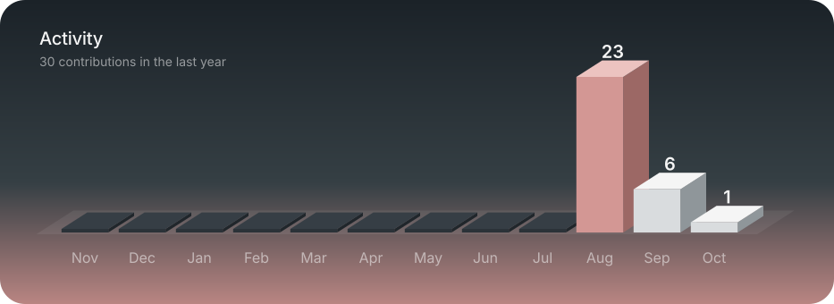

I develop apps for macOS, iOS, and Windows, and create AI workflows for clients and businesses. From the interface to the systems behind it.

[**Explore my work →**](https://ap.patru.eu/projects/) · [About me](https://ap.patru.eu/about/) · [Website](https://ap.patru.eu/)

## The person behind the work

I'm Alvaro Patru, known online as AlvaroP100 — a software and systems developer.

| | |
| --- | --- |
| **App development** | macOS, iOS, iPadOS & Windows |
| **AI workflows** | Business automation, connected tools & APIs |
| **Systems** | IT infrastructure, data & cybersecurity |

## Current roles

- **Chief Technology Officer** — FF Systems România · Jun 2026 – present
- **Application Developer** — Scooly · Aug 2026 – present
- **Developer** — Pavalo Plac Design · Jun 2026 – present
- **Senior Developer** — P Solution · Jun 2026 – present

## Activity

## Elsewhere

[Website](https://ap.patru.eu/) · [LinkedIn](https://www.linkedin.com/in/alvaro-patru/) · [X](https://x.com/Alvaro_P_100) · [Instagram](https://www.instagram.com/alvaro_p_100/)
