I develop apps for macOS, iOS, and Windows, and create AI workflows for clients and businesses. From the interface to the systems behind it. I treat security and data as architecture, not cleanup.

[**Website**](https://ap.patru.eu/) · [Projects](https://ap.patru.eu/projects/) · [Biography](https://ap.patru.eu/about/) · [LinkedIn](https://www.linkedin.com/in/alvaro-patru/) · [X](https://x.com/Alvaro_P_100) · [Instagram](https://www.instagram.com/alvaro_p_100/)

## Work

| Apps & websites | Systems & workflows | Behind the interface |
| --- | --- | --- |
| **Scooly Notes** — a native iPad notebook within Scooly: handwriting, notebook organization, local persistence, synchronization. *In development.* | **Connected workflows** — automation, APIs and AI that make the tools work together. | **Infrastructure, data & security** — servers, deployment, monitoring, PostgreSQL, access rules. |
| **Personal websites** — React and TypeScript interfaces, biography and photo pages, publishing. | **Reliability** — monitoring, status pages and incident communication. | **Privacy by design** — authentication, permissions, row-level security, secrets. |

## Capabilities

| | |
| --- | --- |
| **App development** | macOS, iOS, iPadOS & Windows |
| **AI workflows** | Business automation, connected tools & APIs, document and image flows |
| **Systems** | IT infrastructure, data & cybersecurity |

**Stack** — TypeScript · Next.js · Tailwind CSS · Swift · PencilKit · Supabase · PostgreSQL · GitHub Pages

## Current roles

- **Chief Technology Officer** — FF Systems România · Jun 2026 – present
- **Application Developer** — Scooly · Aug 2026 – present
- **Developer** — Pavalo Plac Design · Jun 2026 – present
- **Senior Developer** — P Solution · Jun 2026 – present

## Commit volume

Every cluster is a real commit from my own repositories, public and private. The cube's axes are **time** (left to right), **hour of day** (bottom to top) and **project** (front to back), and color is **lines changed** on a log scale, from blue (a line or two) to red (thousands). Project names are left out on purpose. Regenerate with `scripts/fetch_commits.py` and `scripts/volume.py`.
