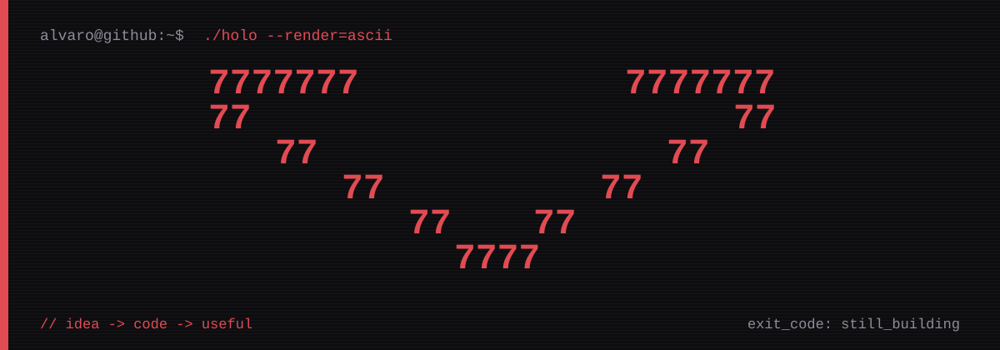
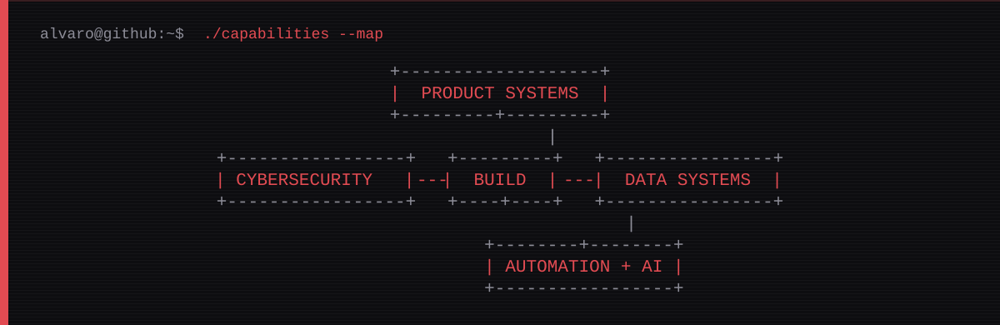

# Alvaro Patru / `AlvaroP100`

> I’m Alvaro Patru, known online as AlvaroP100. I build software, IT infrastructure, automation, and AI systems.

```ts
const currentMode = "design > model > secure > build > ship";
const trustMeBroArchitecture = false;
```

## About my work

I connect application development with data management, access controls, and the infrastructure behind an application. My current work includes Scooly Notes, a native iPad notebook app within Scooly, and my personal websites.

- **Scooly Notes:** handwriting, notebook organization, local persistence, and synchronization. In development.
- **Personal websites:** React and TypeScript interfaces, static biography and photo pages, hosting, and GitHub Pages publishing.

[Read my biography](https://ap.patru.eu/about/) · [Project details and public references](https://ap.patru.eu/projects/)

## `/capabilities`



```text
product systems     web apps / internal tools / APIs / native iPad workflows
data management     PostgreSQL / Supabase / schemas / migrations / access rules
cybersecurity       auth / permissions / data privacy / RLS / secrets / threat models
reliability         monitoring / status pages / incident communication / failure design
automation + AI     model integrations / document flows / image flows / workflow tooling
infrastructure      servers / deployment / monitoring / operational tooling
```

I do not treat security and data as cleanup tasks. They belong in the architecture before the interface starts looking finished.

## `/stack`

```text
web        TypeScript / Next.js / Tailwind CSS
native     Swift / PencilKit
backend    Supabase / PostgreSQL
systems    APIs / automation / monitoring / GitHub Pages
```

## `/rules`

```js
if (clever && !clear) refactor();
if (status === "green" && !evidence) throw new Error("nice try");
if (security === "later") roadmap.reject();
if (readme !== reality) docs.fix();
```

## `/links`

- [`website / ap.patru.eu`](https://ap.patru.eu/)
- [`linkedin / Alvaro Patru`](https://www.linkedin.com/in/alvaro-patru/)
- [`X / @Alvaro_P_100`](https://x.com/Alvaro_P_100)
- [`Instagram / @alvaro_p_100`](https://www.instagram.com/alvaro_p_100/)
- [`source / github.com/AlvaroP100`](https://github.com/AlvaroP100?tab=repositories)
